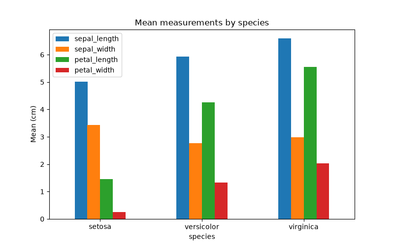

# Iris Dataset Analysis

## Description

This project analyzes the classic **Iris dataset** (150 flowers, 3 species: setosa, versicolor, virginica) with Python, Pandas and Jupyter Notebook. The Python environment and dependencies are managed with `uv`.

What the notebook does:
- Loads `data/iris.csv` into a Pandas DataFrame
- Explores it: shape, data types, missing values, duplicates, species counts, group means, descriptive statistics
- Filters and sorts the data
- Exports the results to CSV files in `output/`
- Adds an extra section with pandas/Matplotlib plots (line, box, scatter, histogram, bar)

**Tools:** Python, uv, Pandas, Jupyter Notebook, Matplotlib

## Project structure

```
iris-analysis/
├── data/
│   └── iris.csv                  # dataset (downloaded with curl)
├── output/
│   ├── species_summary.csv       # summary statistics per species
│   ├── filtered_iris.csv         # flowers with sepal_length > 6
│   └── species_means.png         # bar chart saved from the notebook
├── iris_analysis.ipynb           # full analysis (Tasks 3-6 + plots)
├── pyproject.toml                # project dependencies
├── uv.lock                       # exact dependency versions
└── README.md
```

## Setup (Task 1: Python project with uv)

Commands used (Windows PowerShell), in order:

```powershell
uv init iris-analysis
cd iris-analysis
uv venv
.venv\Scripts\activate
uv add pandas notebook
uv run python -c "import pandas; print(pandas.__version__)"   # verify pandas -> 3.0.6
uv run -m notebook
```

Notes:
- On my machine `uv run jupyter notebook` was blocked by a Windows application-control policy, so I started Jupyter with `uv run -m notebook` (same program).
- If PowerShell blocks activation: `Set-ExecutionPolicy -Scope Process -ExecutionPolicy Bypass`.
- `matplotlib` was added with `uv add matplotlib` for the extra plotting section.

## Download the dataset (Task 2)

```powershell
mkdir data
curl.exe -L -o data/iris.csv https://raw.githubusercontent.com/mwaskom/seaborn-data/master/iris.csv
dir data      # verify: iris.csv exists, size 3858 bytes (not empty)
```

In PowerShell use `curl.exe`; plain `curl` is an alias of `Invoke-WebRequest`.

## How to run

```bash
uv sync                  # creates .venv and installs the exact versions from uv.lock
uv run -m notebook       # opens Jupyter, then open iris_analysis.ipynb
```

Then run all cells (Kernel > Restart & Run All).

## Summary of findings

- The dataset has 150 rows and 5 columns, with no missing values and 1 duplicate row.
- There are 3 species with 50 flowers each, so the data is balanced.
- Average sepal length is about 5.84 cm; the maximum petal length is 6.9 cm; the minimum sepal width is 2.0 cm.
- 61 flowers have `sepal_length > 6` (41 virginica, 20 versicolor); 52 have `petal_width > 1.5`.
- Virginica has the highest average petal length (about 5.55 cm).
- Petal size separates the species best: setosa (petal length 1.0-1.9 cm) is clearly separate from versicolor and virginica, which overlap slightly.

## Output files

- `output/species_summary.csv`: summary statistics (count, mean, std, min, quartiles, max) per species
- `output/filtered_iris.csv`: all flowers with `sepal_length > 6`
- `output/species_means.png`: bar chart of mean measurements per species

